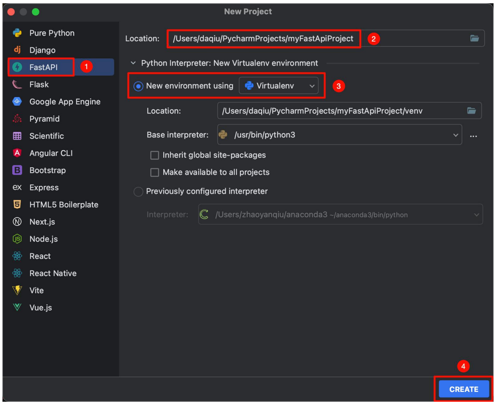
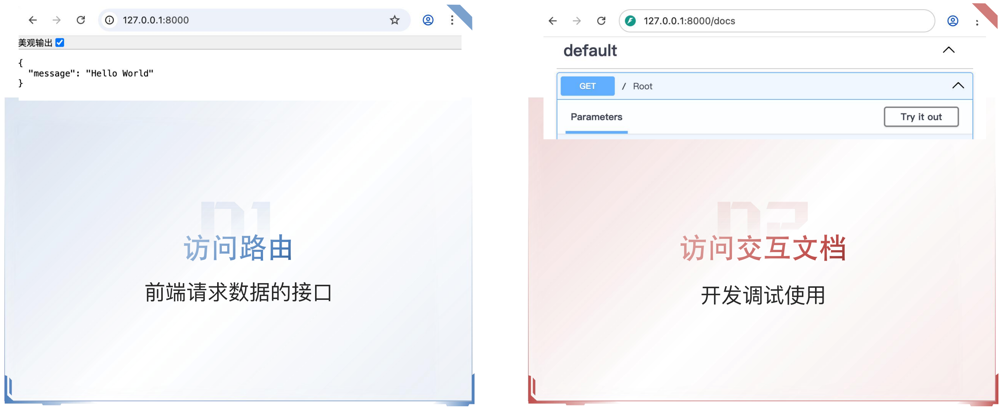
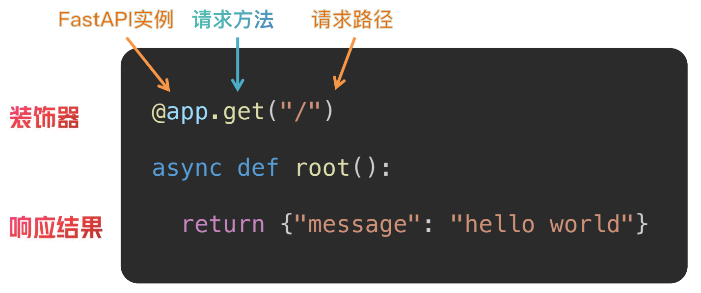

# FastAPI 入门

> FastAPI 基础到实战 · FastAPI 基础入门
>
> 基础程序、路由、请求与响应

## 第一个 FastAPI 程序

FastAPI 框架基础。

使用 FastAPI 框架搭建 Web 服务：

1. 创建项目
   - FastAPI框架
   - 虚拟环境
2. 运行项目
   - run 项目
   - `uvicorn main:app --reload`
3. 访问项目
   - 访问路由
   - 访问交互式文档

### 创建项目

FastAPI → 存储位置及项目名称 → 创建虚拟环境 → Create



### 访问项目

- 访问路由：前端请求数据的接口
- 访问交互式文档：开发调试使用



## 路由

访问 <http://127.0.0.1:8000/>，得到以下响应：

```json
{"message":"Hello World"}
```

什么功能搞定的呢？路由。

### 路由的概念

路由就是 URL 地址和处理函数之间的映射关系，它决定了当用户访问某个特定网址时，服务器应该执行哪段代码来返回结果。

```python
@app.get("/")
async def root():
  return {"message": "hello world"}
```

### 使用装饰器定义路由

FastAPI 的路由定义基于 Python 的装饰器模式。



## 请求参数

### 参数的概念与分类

同一段接口逻辑，根据参数不同返回不同的数据。

- 请求 `/`，返回 `{"message":"Hello World"}`。
- 请求 `/book`，传入 `book_id = 1`，返回图书 1 的信息。
- 请求 `/book`，传入 `book_id = 2`，返回图书 2 的信息。

参数就是客户端发送请求时附带的额外信息和指令。

参数的作用是让同一个接口能根据不同的输入，返回不同的输出，实现动态交互。

| 参数分类 | 位置 | 作用 | 方法 |
| --- | --- | --- | --- |
| 路径参数 | URL 路径的一部分，如 `/book/{id}` | 指向唯一的、特定的资源 | GET |
| 查询参数 | URL `?` 之后，`k1=v1&k2=v2` | 对资源集合进行过滤、排序、分页等操作 | GET |
| 请求体 | HTTP 请求的消息体（body）中 | 创建、更新资源；携带大量数据，如 JSON | POST、PUT 等 |

### 路径参数

#### 基本用法

- 位置：URL 路径的一部分，如 `/book/{id}`。
- 作用：指向唯一的、特定的资源。
- 方法：GET。

为参数添加类型注解：

```python
@app.get("/book/{id}")
async def get_book(id: int):
    return {"id": id, "title": f"这是第{id}本书"}
```

请求 URL：

```text
http://127.0.0.1:8000/book/666
```

返回结果：

```json
{
  "id": 666,
  "title": "这是第666本书"
}
```

#### 类型注解 Path

FastAPI 允许为参数声明额外的信息和校验。

如何限制参数的取值范围？

导入 FastAPI 的 `Path` 函数：

```python
@app.get("/book/{id}")
async def get_book(id: int = Path()):
    return {"id": id, "title": f"这是第{id}本书"}
```

| Path 参数 | 说明 |
| --- | --- |
| `...` | 必填 |
| `gt` / `ge` | 大于 / 大于等于 |
| `lt` / `le` | 小于 / 小于等于 |
| `description` | 描述 |
| `min_length` / `max_length` | 长度限制 |

### 查询参数

#### 声明查询参数

声明的参数不是路径参数时，路径操作函数会把该参数自动解释为查询参数。

- 位置：URL `?` 之后，`k1=v1&k2=v2`。
- 作用：对资源集合进行过滤、排序、分页等操作。
- 方法：GET。

```python
@app.get("/news/news_list")
async def get_news_list(skip: int, limit: int=10):
    return {"skip": skip, "limit": limit}
```

请求 URL：

```text
http://127.0.0.1:8000/news/news_list?skip=0&limit=10
```

#### 类型注解 Query

导入 FastAPI 的 `Query` 函数：

```python
@app.get("/user")
async def get_book(user_id: int = Query()):
    return {"id": id, "title": f"这是第{id}本书"}
```

| Query 参数 | 说明 |
| --- | --- |
| `...` | 必填 |
| `gt` / `ge` | 大于 / 大于等于 |
| `lt` / `le` | 小于 / 小于等于 |
| `description` | 描述 |
| `min_length` / `max_length` | 长度限制 |

### 请求体参数

#### HTTP 请求的组成

- 位置：HTTP 请求的消息体（body）中。
- 作用：创建、更新资源；携带大量数据，如 JSON。
- 方法：POST、PUT 等。

在 HTTP 协议中，一个完整的请求由三部分组成：

1. 请求行：包含方法、URL、协议版本。
2. 请求头：元数据信息（Content-Type、Authorization 等）。
3. 请求体：实际要发送的数据内容。

#### 定义和使用请求体参数

1. 定义类型。

```python
from pydantic import BaseModel

class User(BaseModel):
    username: str
    password: str
```

2. 类型注解。

```python
@app.post("/register")
async def register(user: User):
    return user
```

请求示例：

```bash
curl -X 'POST' \
  'http://127.0.0.1:8000/register' \
  -H 'accept: application/json' \
  -H 'Content-Type: application/json' \
  -d '{
  "username": "daqiu",
  "password": "123456"
}'
```

#### 类型注解 Field

导入 pydantic 的 `Field` 函数：

```python
from pydantic import BaseModel, Field

class User(BaseModel):
    username: str = Field(...)
    password: str = Field(...)
```

| Field 参数 | 说明 |
| --- | --- |
| `...` | 必填 |
| `gt` / `ge` | 大于 / 大于等于 |
| `lt` / `le` | 小于 / 小于等于 |
| `default` | 默认值 |
| `description` | 描述 |
| `min_length` / `max_length` | 长度限制 |

## 请求与响应


### 默认 JSON 响应

默认情况下，FastAPI 会自动将路径操作函数返回的 Python 对象（字典、列表、Pydantic 模型等），经由 `jsonable_encoder` 转换为 JSON 兼容格式，并包装为 `JSONResponse` 返回。这省去了手动序列化的步骤，让开发者能更专注于业务逻辑。

```python
@app.get("/")
async def root():
    return {"message": "hello world"}
```

如果需要返回非 JSON 数据（如 HTML、文件流），FastAPI 提供了丰富的响应类型来返回不同数据。

### FastAPI 内置响应类型

| 响应类型 | 用途 | 示例 |
| --- | --- | --- |
| `JSONResponse` | 默认响应，返回 JSON 数据 | `return {"key": "value"}` |
| `HTMLResponse` | 返回 HTML 内容 | `return HTMLResponse(html_content)` |
| `PlainTextResponse` | 返回纯文本 | `return PlainTextResponse("text")` |
| `FileResponse` | 返回文件下载 | `return FileResponse(path)` |
| `StreamingResponse` | 流式响应 | 生成器函数返回数据 |
| `RedirectResponse` | 重定向 | `return RedirectResponse(url)` |

### 响应类型设置方式

#### 装饰器中指定响应类

场景：固定返回类型（HTML、纯文本等）。

```python
@app.get("/html", response_class=HTMLResponse)
async def get_html():
    return "<h1>这是标题</h1>"
```

#### 返回响应对象

场景：文件下载、图片、流式响应。

```python
@app.get("/file")
async def get_file():
    file_path = "./files/1.jpeg"
    return FileResponse(file_path)
```

### 响应 HTML 格式

设置响应类为 `HTMLResponse`，当前接口即可返回 HTML 内容。

```python
from fastapi.responses import HTMLResponse

@app.get("/html", response_class=HTMLResponse)
async def get_html():
    return "<h1>Hello World</h1>"
```


### 响应文件格式

`FileResponse` 是 FastAPI 提供的专门用于高效返回文件内容（如图片、PDF、Excel、音视频等）的响应类。它能够智能处理文件路径、媒体类型推断、范围请求和缓存头部，是服务静态文件的推荐方式。

```python
from fastapi.responses import FileResponse

@app.get("/file")
async def get_file():
    file_path = "./files/1.jpeg"
    return FileResponse(file_path)
```


## 自定义响应数据格式

### 直接返回字典

```python
@app.get("/news/{id}")
async def get_news(id: int):
    return {
        "id": id,
    }
```

```python
@app.get("/news/{id}")
async def get_news(id: int):
    return {
        "id": id,
        "title": f"这是第{id}本书"
    }
```

```python
@app.get("/news/{id}")
async def get_news(id: int):
    return {
        "id": id,
        "title": f"这是第{id}本书",
        "content": "这是一本好书"
    }
```

> 感觉哪里怪怪的

### 使用 response_model

`response_model` 是路径操作装饰器（如 `@app.get` 或 `@app.post`）的关键参数，它通过一个 Pydantic 模型来严格定义和约束 API 端点的输出格式。这一机制在提供自动数据验证和序列化的同时，更是保障数据安全性的第一道防线。

```python
from pydantic import BaseModel

class News(BaseModel):
    id: int
    title: str
    content: str

@app.get("/news/{id}", response_model=News)
async def get_news(id: int):
    return {
        "id": id,
        "title": f"这是第{id}本书",
        "content": "这是一本好书"
    }
```

## 异常处理

对于客户端引发的错误（4xx，如资源未找到、认证失败），应使用 `fastapi.HTTPException` 来中断正常处理流程，并返回标准错误响应。

```python
from fastapi import FastAPI, HTTPException

@app.get('/news/{id}')
async def get_news(id: int):
    id_list = [1, 2, 3, 4, 5, 6]
    if id not in id_list:
        raise HTTPException(status_code=404, detail="当前id不存在")
    return {"id": id}
```

请求路径：`/news/100`。

返回结果：

```json
{
    "detail": "当前id不存在"
}
```
