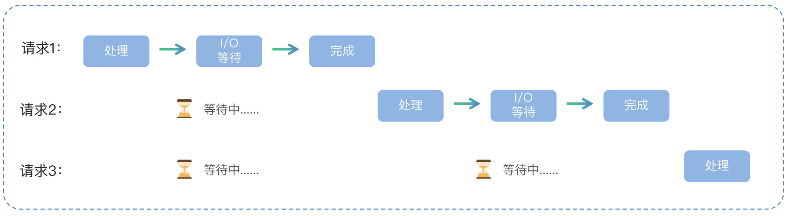
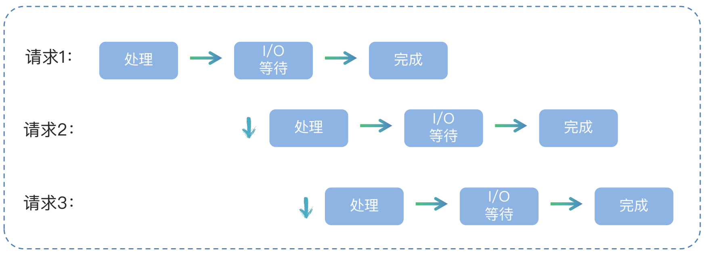
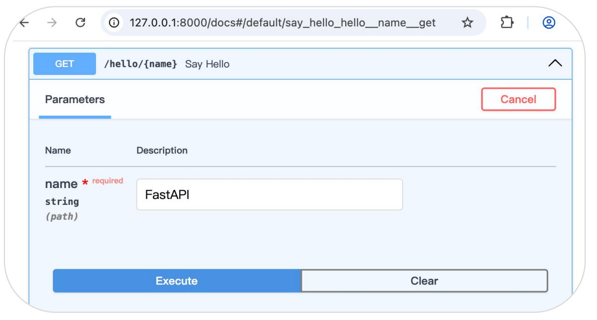

# FastAPI 简介

FastAPI 是一个基于 Python 的高性能 Web 框架，专门用于快速构建 API 接口服务。

## 原生异步支持

FastAPI - 原生异步支持，释放真正性

## 同步与异步

同步：

```python
@app.get("/sync")
def func_sync():
  start = time.time()
  for i in range(10):
    time.sleep(1)
  end = time.time()
  return {"time": f'{end-start:.2f}s'}
```

10秒+

异步：

```python
@app.get("/async")
async def func_async():
  start = time.time()
  tasks = [asyncio.sleep(1) for i in range(10)]
  await asyncio.gather(*tasks)
  end = time.time()
  return {"time": f'{end-start:.2f}s'}
```

1秒

### 同步



### 异步



## 开发体验好

### 类型提示与验证

Pydantic 类型提示与验证，减少手动校验代码。

```python
from pydantic import BaseModel
class User(BaseModel):
  username: str
  password: str

@app.post("/register")
async def register(user: User):
  return user
```

### 可交互式文档

自动生成可交互式文档，浏览器中直接调用和测试 API。



## FastAPI 的特点

- 异步性能高
- 开发效率高
- 自动生成文档
