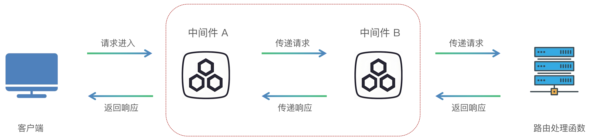

# 中间件

## 统一处理逻辑

使用中间件为每个请求前后添加统一的处理逻辑。

1. 多个接口都需要验证用户身份。
2. 多个接口都需要记录日志、性能数据。

## 应用场景

- 日志记录
- 身份认证
- 跨域处理
- 响应头处理
- 性能监控

## 中间件的概念与执行流程

中间件（Middleware）是一个在每次请求进入 FastAPI 应用时都会被执行的函数。

它在请求到达实际的路径操作（路由处理函数）之前运行，并且在响应返回给客户端之前再运行一次。



自下而上。

## 定义中间件

中间件：函数的顶部使用装饰器 `@app.middleware("http")`。

```python
@app.middleware("http")
async def middleware(request, call_next):
  print('中间件开始处理 -- start')
  response = await call_next(request)
  print('中间件处理完成 -- end')
  return response
```

- `request`：请求。
- `call_next`：传递请求给路径处理函数。
